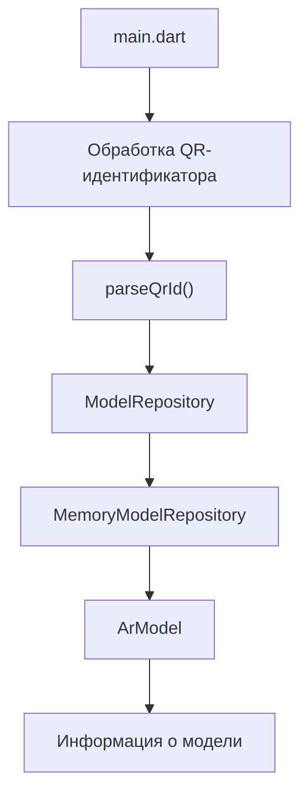

# AR Model Viewer

<p align="center">
  <strong>Учебный проект приложения для работы с 3D-моделями и дополненной реальностью</strong>
</p>

<p align="center">
  
  
  
</p>

<p align="center">
  <a href="#лабораторная-работа-1--модель-данных">ЛР № 1</a> ·
  <a href="#лабораторная-работа-2--репозиторий-объектов">ЛР № 2</a> ·
  <a href="#рефакторинг-и-улучшения">Рефакторинг(ЛР1-2)</a> ·
  <a href="#архитектура-проекта">Архитектура</a> ·
  <a href="#запуск-проекта">Запуск</a> ·
  <a href="./Demonstration/">Демонстрация</a>
</p>

---

## О проекте

**AR Model Viewer** — учебный проект, направленный на последовательное освоение разработки мобильных приложений на Dart и Flutter.

В рамках лабораторных работ создаётся программная основа будущего приложения для поиска, хранения и просмотра трёхмерных моделей с использованием дополненной реальности.

Разработка ведётся поэтапно: каждая лабораторная работа расширяет существующий проект и добавляет новые компоненты, необходимые для реализации итогового приложения.

На текущем этапе реализована консольная часть на Dart, отвечающая за описание моделей, организацию доступа к данным и поиск объектов по идентификатору.

## Цель проекта
Создать мобильное приложение, которое позволит пользователю:

- Просматривать каталог доступных 3D-моделей.
- Сканировать QR-код и получать идентификатор объекта.
- Находить соответствующую модель по идентификатору.
- Получать информацию о выбранном объекте.
- Просматривать 3D-модели в режиме дополненной реальности.
- В дальнейшем использовать локальную базу данных SQLite для хранения информации.

Перечисленные возможности относятся к общей цели проекта. Полноценный мобильный интерфейс, считывание QR-кодов камерой, SQLite и AR-просмотр в текущей консольной версии ещё не реализованы.

## Содержание

- [Лабораторная работа № 1 — Модель данных](#лабораторная-работа-1--модель-данных)
- [Лабораторная работа № 2 — Репозиторий объектов](#лабораторная-работа-2--репозиторий-объектов)
- [Архитектура проекта](#архитектура-проекта)
- [Структура проекта](#структура-проекта)
- [Технологии](#технологии)
- [Запуск проекта](#запуск-проекта)
- [Планы развития](#планы-развития)
- [Разработчик](#разработчик)

---

## Лабораторная работа № 1 — Модель данных

**Цель:** освоить основные возможности Dart и разработать модель данных для описания трёхмерных объектов.

### Реализовано

- Создан класс `ArModel` для представления 3D-модели.
- Определены поля для хранения идентификатора, названия, описания, пути к файлу, типа объекта и масштаба модели.
- Реализовано создание объектов с помощью конструкторов.
- Добавлено преобразование данных из `Map` с помощью `ArModel.fromMap()`.
- Подготовлен демонстрационный каталог 3D-моделей.
- Реализован поиск объектов по идентификатору.
- Добавлена обработка строковых значений, представляющих QR-идентификаторы.
- Использован `int.tryParse()` для безопасного преобразования строки в число.
- Предусмотрена обработка некорректных идентификаторов и отсутствующих объектов.

### Модель данных

Основная сущность проекта — `ArModel`.

| Поле | Назначение |
|---|---|
| `id` | Идентификатор объекта |
| `name` | Название модели |
| `description` | Описание объекта |
| `modelPath` | Путь к файлу 3D-модели |
| `type` | Тип модели, представленный через `ArModelType` |
| `scale` | Масштаб модели |

Дополнительные элементы модели:

- `fileName` — получение имени файла модели из пути.
- `typeName` — получение человекочитаемого названия типа.
- `ArModel.fromMap()` — создание экземпляра модели на основе данных `Map`.

### Демонстрационный каталог

В текущей версии программы представлены 7 объектов:

| ID | Название |
|---:|---|
| 1 | Robot |
| 2 | Space Helmet |
| 3 | Planet |
| 4 | Astronaut |
| 5 | Engine |
| 6 | Hammer |
| 7 | Dog |

Пути к файлам моделей хранятся в поле `modelPath`. Наличие такого пути в данных само по себе не означает, что программа уже загружает и отображает 3D-модель.

### Демонстрация работы

<p align="center">
  
</p>

<p align="center">
  <em>Результат выполнения лабораторной работы № 1: модель данных и примеры работы с объектами.</em>
</p>

Материалы демонстрации: [папка Demonstration](./Demonstration/).

---

## Лабораторная работа № 2 — Репозиторий объектов

**Цель:** отделить описание данных от способа их хранения, применить принципы объектно-ориентированного программирования и организовать асинхронный доступ к объектам.

### Реализовано

- Создано перечисление `ArModelType` для классификации моделей.
- Определён абстрактный интерфейс `ModelRepository`.
- Реализован класс `MemoryModelRepository`, хранящий объекты в памяти.
- Добавлены асинхронные методы получения списка и поиска моделей.
- Реализован метод `getAll()` для получения каталога.
- Реализован метод `getById()` для поиска по идентификатору.
- Добавлена функция `parseQrId()` для проверки и преобразования строкового идентификатора.
- Добавлена функция `findModelByQr()` для поиска модели по QR-идентификатору через интерфейс репозитория.
- Предусмотрена обработка некорректного ввода и ситуации, когда объект не найден.

### Типизация моделей

Перечисление `ArModelType` определяет типы объектов:

| Значение | Назначение |
|---|---|
| `technic` | Техника |
| `space` | Космические объекты |
| `equipment` | Оборудование |
| `other` | Прочие объекты |

### Интерфейс репозитория

`ModelRepository` определяет общий контракт доступа к данным:

```dart
Future<List<ArModel>> getAll();

Future<ArModel?> getById(int id);
```

Метод `getAll()` возвращает список моделей, а `getById()` — объект с указанным идентификатором или `null`, если совпадение отсутствует.

`MemoryModelRepository` реализует этот интерфейс на основе коллекции объектов в оперативной памяти.

Такое разделение позволяет изменять способ хранения данных, не привязывая клиентскую логику к конкретному списку или реализации репозитория.

### Алгоритм обработки QR-идентификатора

На текущем этапе программа обрабатывает строку, представляющую содержимое QR-кода. Считывание QR-кода непосредственно с камеры устройства пока не входит в реализованную функциональность.

Последовательность обработки:

1. Удаление пробелов в начале и конце строки.
2. Проверка значения на пустоту.
3. Преобразование строки в целое число с помощью `int.tryParse()`.
4. Проверка допустимости идентификатора.
5. Поиск модели через `ModelRepository`.
6. Возврат результата поиска либо обработка ошибки.

Некорректный формат идентификатора обрабатывается отдельно от ситуации, когда корректный ID отсутствует в каталоге.

### Демонстрация работы

<p align="center">
  
</p>

<p align="center">
  <em>Результат выполнения лабораторной работы № 2: Все объекты в системе</em>
</p>

<p align="center">
  
</p>

<p align="center">
  <em>Результат выполнения лабораторной работы № 2: Поиск по QR</em>
</p>

<p align="center">
  
</p>

<p align="center">
  <em>Результат выполнения лабораторной работы № 2: Работа FromMap()</em>
</p>

Материалы демонстрации: [папка Demonstration](./Demonstration/).

---
## Рефакторинг и улучшения

В соответствии с обновлёнными требованиями методических указаний был проведён масштабный рефакторинг проекта. Его основные задачи — повысить качество кода, улучшить архитектуру, сделать обработку входных данных более строгой и привести реализацию к требованиям разработки на Dart.

### 1. Обновление модели данных

- **Переименование поля:** `name` заменено на `title` для большей семантической точности.
- **Новое поле:** `previewPath` предназначено для хранения пути к изображению предварительного просмотра модели.
- **Валидация в конструкторе:** при создании объекта проверяются основные инварианты. При нарушении требований выбрасывается `ArgumentError`.

Проверки включают:

- допустимый диапазон `id`: от `1` до `2147483647`;
- запрет пустых значений `title` и `description` после вызова `trim()`;
- проверку расширения `.glb` у `modelPath`;
- проверку положительности `scale`.

Такая валидация позволяет обнаруживать некорректные данные на этапе создания модели, а не при последующем использовании объекта.

### 2. Строгий парсинг QR-кодов

Функция `parseQrId()` переработана в соответствии с пунктом 46 методических указаний к лабораторной работе № 1.

Основные изменения:

- Для проверки формата применяется регулярное выражение `^[0-9]+$`.
- Допускаются только десятичные цифры.
- Не допускаются знаки `+` и `-`, внутренние пробелы и другие символы.
- Отклоняются шестнадцатеричные значения, например `0x10`, дробные числа и пустые строки.
- Функция возвращает `int?`: при корректном вводе — идентификатор, при некорректном — `null`.
- После преобразования дополнительно проверяется допустимый диапазон ID.

Строгая проверка формата исключает неоднозначную интерпретацию входных значений и позволяет обработать некорректный QR-идентификатор без выбрасывания исключения из самой функции парсинга.

### 3. Расширение функциональности репозитория

Интерфейс `ModelRepository` расширен до полноценного CRUD:

```dart
Future<void> insert(ArModel model);
Future<bool> update(ArModel model);
Future<bool> delete(int id);
```

Вместе с ранее реализованными `getAll()` и `getById()` интерфейс охватывает основные операции управления каталогом.

Особенности реализации:

- `insert()` добавляет новую модель и выбрасывает `RepositoryException` при попытке вставить дубликат.
- `update()` обновляет существующую запись и возвращает `bool`, указывающий на результат операции.
- `delete()` удаляет запись по идентификатору и возвращает `bool`.
- `getAll()` возвращает неизменяемый список с помощью `List.unmodifiable()`.

Такой подход ограничивает прямое изменение внутренней коллекции извне и делает поведение репозитория более предсказуемым.

### 4. Интерактивный консольный интерфейс

В точке входа программы реализован интерактивный цикл ввода с использованием `stdin.readLineSync()`.

Добавлены:

- взаимодействие с пользователем через консоль;
- автоматическая демонстрация CRUD-операций при запуске;
- обработка команды выхода `q`;
- корректное завершение при достижении конца потока ввода — Ctrl+D в Unix-подобных системах и Ctrl+Z в Windows.

Таким образом, программа демонстрирует не только отдельные методы, но и сценарии взаимодействия с каталогом объектов.

### 5. Юнит-тестирование

Добавлено комплексное покрытие автоматизированными тестами. Всего подготовлено **34 теста**.

| Файл тестов | Проверяемая функциональность |
|---|---|
| `ar_model_test.dart` | Валидация модели, конструктор `fromMap()`, геттеры |
| `qr_parser_test.dart` | Корректные и некорректные значения QR-идентификаторов |
| `model_repository_test.dart` | CRUD-операции, изоляция данных, обработка дубликатов |

Тесты позволяют проверять поведение компонентов независимо от ручного запуска интерактивной программы и упрощают проверку корректности при дальнейших изменениях кода.

### Демонстрация рефакторинга

<p align="center">
  
</p>

<p align="center">
  <em>Консольный интерфейс со всеми моделями.</em>
</p>

<p align="center">
  
</p>

<p align="center">
  <em>Демонстрация CRUD-операций: добавление, обновление, удаление и обработка дубликатов.</em>
</p>

<p align="center">
  
</p>

<p align="center">
  <em>Интерактивный консольный интерфейс с обработкой ввода пользователя.</em>
</p>

<p align="center">
  
</p>

<p align="center">
  <em>Успешное прохождение всех 34 юнит-тестов.</em>
</p>

Все изображения размещены в каталоге [Demonstration](./Demonstration/).

---

## Архитектура проекта

Архитектура разделяет модель данных, интерфейс доступа к данным и реализацию хранения.



### Назначение компонентов

| Компонент | Ответственность |
|---|---|
| `ArModel` | Описание свойств 3D-модели |
| `ArModelType` | Типизация объектов |
| `ModelRepository` | Определение интерфейса доступа к данным |
| `MemoryModelRepository` | Хранение и поиск объектов в памяти |
| `main.dart` | Создание демонстрационных данных и запуск сценариев |


---

## Структура проекта

```text
ar-model-viewer_DART-FLUTTER/
├── Demonstration/
│   ├── LR1.png                    # Демонстрация лабораторной работы № 1
│   └── LR2_1.png                    # Демонстрация лабораторной работы № 2
├── bin/
│   └── main.dart                   # Точка входа программы
├── lib/
│   ├── ar_model.dart               # Модель данных и тип модели
│   ├── model_repository.dart       # Интерфейс репозитория
│   └── memory_model_repository.dart # Хранилище в памяти
├── .gitignore                      # Исключения Git
├── CHANGELOG.md                    # История изменений
├── analysis_options.yaml            # Настройки анализа Dart
├── pubspec.yaml                    # Конфигурация пакета
├── pubspec.lock                    # Зафиксированные зависимости
└── README.md                       # Документация проекта
```
---

## Технологии

| Технология | Назначение | Статус |
|---|---|---|
| Dart | Модель данных и логика приложения | Используется |
| Dart SDK | Запуск консольной программы | Используется |
| `Future`, `async/await` | Асинхронный доступ к данным | Используется |
| Git | Контроль версий | Используется |
| GitHub | Хранение исходного кода | Используется |
| Flutter | Мобильный интерфейс | Планируется |
| SQLite | Постоянное локальное хранение | Планируется |
| AR | Отображение моделей в дополненной реальности | Планируется |

---

## Запуск проекта

### Требования

- Установленный [Dart SDK](https://dart.dev/get-dart).
- Git.
- Терминал или командная строка.

### 1. Клонирование репозитория

```bash
git clone https://github.com/Dimasyaaa/ar-model-viewer_DART-FLUTTER.git
```

### 2. Переход в каталог проекта

```bash
cd ar-model-viewer_DART-FLUTTER
```

### 3. Получение зависимостей

```bash
dart pub get
```

### 4. Запуск программы

```bash
dart run bin/main.dart
```

После запуска выполняются сценарии, предусмотренные точкой входа программы: создание демонстрационного каталога, получение данных и поиск моделей.

---


## Разработчик

**Корнилов Дмитрий Сергеевич**

Группа: **ИВТ-ВТД-23**

Учебный проект, разрабатываемый в рамках лабораторных работ по Dart и Flutter.

