# AR Model Viewer

<p align="center">
  <strong>Учебный проект приложения для работы с 3D-моделями и дополненной реальностью</strong>
</p>

<p align="center">
  
  
  
</p>

<p align="center">
  <a href="#лабораторная-работа-1--модель-данных">ЛР № 1</a> ·
  <a href="#лабораторная-работа-2--репозиторий-объектов">ЛР № 2</a> ·
  <a href="#рефакторинг-и-улучшения">Рефакторинг</a> ·
  <a href="#лабораторная-работа-3--каркас-мобильного-приложения">ЛР № 3</a> ·
  <a href="#лабораторная-работа-4--навигация-и-каталог">ЛР № 4</a> ·
  <a href="#лабораторная-работа-5--анимации-приложения">ЛР № 5</a> ·
  <a href="#лабораторная-работа-6--локальная-база-3d-моделей">ЛР № 6</a> ·
  <a href="#архитектура-проекта">Архитектура</a> ·
  <a href="#запуск-проекта">Запуск</a> ·
  <a href="./Demonstration/">Демонстрация</a>
</p>

---

## О проекте

**AR Model Viewer** — учебный проект, направленный на последовательное освоение разработки мобильных приложений на Dart и Flutter.

В рамках лабораторных работ создаётся программная основа будущего приложения для поиска, хранения и просмотра трёхмерных моделей с использованием дополненной реальности.

Разработка ведётся поэтапно: каждая лабораторная работа расширяет существующий проект и добавляет новые компоненты, необходимые для реализации итогового приложения.

На текущем этапе реализована консольная часть на Dart, отвечающая за описание моделей, организацию доступа к данным и поиск объектов по идентификатору.

## Цель проекта
Создать мобильное приложение, которое позволит пользователю:

- Просматривать каталог доступных 3D-моделей.
- Сканировать QR-код и получать идентификатор объекта.
- Находить соответствующую модель по идентификатору.
- Получать информацию о выбранном объекте.
- Просматривать 3D-модели в режиме дополненной реальности.
- В дальнейшем использовать локальную базу данных SQLite для хранения информации.

Перечисленные возможности относятся к общей цели проекта. Полноценный мобильный интерфейс, считывание QR-кодов камерой, SQLite и AR-просмотр в текущей консольной версии ещё не реализованы.

## Содержание

- [AR Model Viewer](#ar-model-viewer)
  - [О проекте](#о-проекте)
  - [Цель проекта](#цель-проекта)
  - [Содержание](#содержание)
  - [Лабораторная работа № 1 — Модель данных](#лабораторная-работа--1--модель-данных)
    - [Реализовано](#реализовано)
    - [Модель данных](#модель-данных)
    - [Демонстрационный каталог](#демонстрационный-каталог)
    - [Демонстрация работы](#демонстрация-работы)
  - [Лабораторная работа № 2 — Репозиторий объектов](#лабораторная-работа--2--репозиторий-объектов)
    - [Реализовано](#реализовано-1)
    - [Типизация моделей](#типизация-моделей)
    - [Интерфейс репозитория](#интерфейс-репозитория)
    - [Алгоритм обработки QR-идентификатора](#алгоритм-обработки-qr-идентификатора)
    - [Демонстрация работы](#демонстрация-работы-1)
  - [Рефакторинг и улучшения](#рефакторинг-и-улучшения)
    - [1. Обновление модели данных](#1-обновление-модели-данных)
    - [2. Строгий парсинг QR-кодов](#2-строгий-парсинг-qr-кодов)
    - [3. Расширение функциональности репозитория](#3-расширение-функциональности-репозитория)
    - [4. Интерактивный консольный интерфейс](#4-интерактивный-консольный-интерфейс)
    - [5. Юнит-тестирование](#5-юнит-тестирование)
    - [Демонстрация рефакторинга](#демонстрация-рефакторинга)
  - [Лабораторная работа № 3 — Каркас мобильного приложения](#лабораторная-работа--3--каркас-мобильного-приложения)
    - [Реализовано](#реализовано-2)
    - [Структура экранов](#структура-экранов)
    - [Проверка и запуск](#проверка-и-запуск)
    - [Демонстрация ЛР № 3](#демонстрация-лр--3)
  - [Лабораторная работа № 4 — Навигация и каталог](#лабораторная-работа--4--навигация-и-каталог)
    - [Карточка модели (`ModelCard`)](#карточка-модели-modelcard)
    - [Адаптивный каталог](#адаптивный-каталог)
    - [Навигация между экранами](#навигация-между-экранами)
    - [Ручной ввод идентификатора в `ScannerScreen`](#ручной-ввод-идентификатора-в-scannerscreen)
    - [Widget-тестирование](#widget-тестирование)
    - [Навигационная схема](#навигационная-схема)
    - [Демонстрация ЛР № 4](#демонстрация-лр--4)
  - [Лабораторная работа № 5 — Анимации приложения](#лабораторная-работа--5--анимации-приложения)
    - [Реализовано](#реализовано-3)
    - [Технологии анимации](#технологии-анимации)
    - [Сценарии использования анимаций](#сценарии-использования-анимаций)
    - [Widget-тестирование](#widget-тестирование-1)
    - [Демонстрация ЛР № 5](#демонстрация-лр--5)
  - [Лабораторная работа № 6 — Локальная база 3D-моделей](#лабораторная-работа--6--локальная-база-3d-моделей)
    - [Реализовано](#реализовано-4)
    - [Схема таблицы `ar_models`](#схема-таблицы-ar_models)
    - [Архитектура работы с базой данных](#архитектура-работы-с-базой-данных)
    - [Интеграционное тестирование](#интеграционное-тестирование)
    - [Демонстрация ЛР № 6](#демонстрация-лр--6)
  - [Архитектура проекта](#архитектура-проекта)
    - [Назначение компонентов](#назначение-компонентов)
  - [Структура проекта](#структура-проекта)
  - [Технологии](#технологии)
  - [Запуск проекта](#запуск-проекта)
    - [Требования](#требования)
    - [1. Клонирование репозитория](#1-клонирование-репозитория)
    - [2. Переход в каталог проекта](#2-переход-в-каталог-проекта)
    - [3. Получение зависимостей](#3-получение-зависимостей)
    - [4. Запуск консольной версии](#4-запуск-консольной-версии)
    - [5. Запуск Flutter-приложения (ЛР № 3–6)](#5-запуск-flutter-приложения-лр--36)
  - [Разработчик](#разработчик)

---

## Лабораторная работа № 1 — Модель данных

**Цель:** освоить основные возможности Dart и разработать модель данных для описания трёхмерных объектов.

### Реализовано

- Создан класс `ArModel` для представления 3D-модели.
- Определены поля для хранения идентификатора, названия, описания, пути к файлу, типа объекта и масштаба модели.
- Реализовано создание объектов с помощью конструкторов.
- Добавлено преобразование данных из `Map` с помощью `ArModel.fromMap()`.
- Подготовлен демонстрационный каталог 3D-моделей.
- Реализован поиск объектов по идентификатору.
- Добавлена обработка строковых значений, представляющих QR-идентификаторы.
- Использован `int.tryParse()` для безопасного преобразования строки в число.
- Предусмотрена обработка некорректных идентификаторов и отсутствующих объектов.

### Модель данных

Основная сущность проекта — `ArModel`.

| Поле | Назначение |
|---|---|
| `id` | Идентификатор объекта |
| `name` | Название модели |
| `description` | Описание объекта |
| `modelPath` | Путь к файлу 3D-модели |
| `type` | Тип модели, представленный через `ArModelType` |
| `scale` | Масштаб модели |

Дополнительные элементы модели:

- `fileName` — получение имени файла модели из пути.
- `typeName` — получение человекочитаемого названия типа.
- `ArModel.fromMap()` — создание экземпляра модели на основе данных `Map`.

### Демонстрационный каталог

В текущей версии программы представлены 7 объектов:

| ID | Название |
|---:|---|
| 1 | Robot |
| 2 | Space Helmet |
| 3 | Planet |
| 4 | Astronaut |
| 5 | Engine |
| 6 | Hammer |
| 7 | Dog |

Пути к файлам моделей хранятся в поле `modelPath`. Наличие такого пути в данных само по себе не означает, что программа уже загружает и отображает 3D-модель.

### Демонстрация работы

<p align="center">
  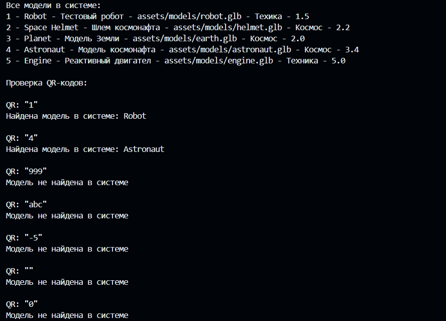
</p>

<p align="center">
  <em>Результат выполнения лабораторной работы № 1: модель данных и примеры работы с объектами.</em>
</p>

Материалы демонстрации: [папка Demonstration](./Demonstration/).

---

## Лабораторная работа № 2 — Репозиторий объектов

**Цель:** отделить описание данных от способа их хранения, применить принципы объектно-ориентированного программирования и организовать асинхронный доступ к объектам.

### Реализовано

- Создано перечисление `ArModelType` для классификации моделей.
- Определён абстрактный интерфейс `ModelRepository`.
- Реализован класс `MemoryModelRepository`, хранящий объекты в памяти.
- Добавлены асинхронные методы получения списка и поиска моделей.
- Реализован метод `getAll()` для получения каталога.
- Реализован метод `getById()` для поиска по идентификатору.
- Добавлена функция `parseQrId()` для проверки и преобразования строкового идентификатора.
- Добавлена функция `findModelByQr()` для поиска модели по QR-идентификатору через интерфейс репозитория.
- Предусмотрена обработка некорректного ввода и ситуации, когда объект не найден.

### Типизация моделей

Перечисление `ArModelType` определяет типы объектов:

| Значение | Назначение |
|---|---|
| `technic` | Техника |
| `space` | Космические объекты |
| `equipment` | Оборудование |
| `other` | Прочие объекты |

### Интерфейс репозитория

`ModelRepository` определяет общий контракт доступа к данным:

```dart
Future<List<ArModel>> getAll();

Future<ArModel?> getById(int id);
```

Метод `getAll()` возвращает список моделей, а `getById()` — объект с указанным идентификатором или `null`, если совпадение отсутствует.

`MemoryModelRepository` реализует этот интерфейс на основе коллекции объектов в оперативной памяти.

Такое разделение позволяет изменять способ хранения данных, не привязывая клиентскую логику к конкретному списку или реализации репозитория.

### Алгоритм обработки QR-идентификатора

На текущем этапе программа обрабатывает строку, представляющую содержимое QR-кода. Считывание QR-кода непосредственно с камеры устройства пока не входит в реализованную функциональность.

Последовательность обработки:

1. Удаление пробелов в начале и конце строки.
2. Проверка значения на пустоту.
3. Преобразование строки в целое число с помощью `int.tryParse()`.
4. Проверка допустимости идентификатора.
5. Поиск модели через `ModelRepository`.
6. Возврат результата поиска либо обработка ошибки.

Некорректный формат идентификатора обрабатывается отдельно от ситуации, когда корректный ID отсутствует в каталоге.

### Демонстрация работы

<p align="center">
  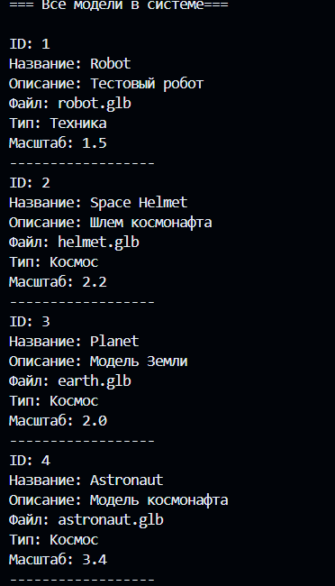
</p>

<p align="center">
  <em>Результат выполнения лабораторной работы № 2: Все объекты в системе</em>
</p>

<p align="center">
  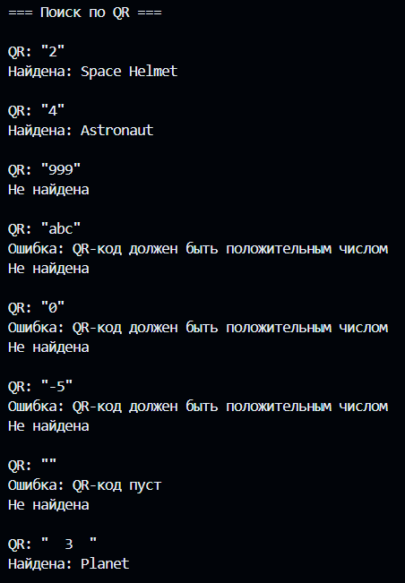
</p>

<p align="center">
  <em>Результат выполнения лабораторной работы № 2: Поиск по QR</em>
</p>

<p align="center">
  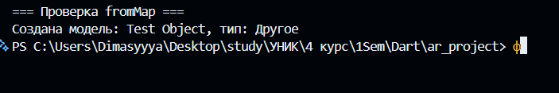
</p>

<p align="center">
  <em>Результат выполнения лабораторной работы № 2: Работа FromMap()</em>
</p>

Материалы демонстрации: [папка Demonstration](./Demonstration/).

---
## Рефакторинг и улучшения

В соответствии с обновлёнными требованиями методических указаний был проведён масштабный рефакторинг проекта. Его основные задачи — повысить качество кода, улучшить архитектуру, сделать обработку входных данных более строгой и привести реализацию к требованиям разработки на Dart.

### 1. Обновление модели данных

- **Переименование поля:** `name` заменено на `title` для большей семантической точности.
- **Новое поле:** `previewPath` предназначено для хранения пути к изображению предварительного просмотра модели.
- **Валидация в конструкторе:** при создании объекта проверяются основные инварианты. При нарушении требований выбрасывается `ArgumentError`.

Проверки включают:

- допустимый диапазон `id`: от `1` до `2147483647`;
- запрет пустых значений `title` и `description` после вызова `trim()`;
- проверку расширения `.glb` у `modelPath`;
- проверку положительности `scale`.

Такая валидация позволяет обнаруживать некорректные данные на этапе создания модели, а не при последующем использовании объекта.

### 2. Строгий парсинг QR-кодов

Функция `parseQrId()` переработана в соответствии с пунктом 46 методических указаний к лабораторной работе № 1.

Основные изменения:

- Для проверки формата применяется регулярное выражение `^[0-9]+$`.
- Допускаются только десятичные цифры.
- Не допускаются знаки `+` и `-`, внутренние пробелы и другие символы.
- Отклоняются шестнадцатеричные значения, например `0x10`, дробные числа и пустые строки.
- Функция возвращает `int?`: при корректном вводе — идентификатор, при некорректном — `null`.
- После преобразования дополнительно проверяется допустимый диапазон ID.

Строгая проверка формата исключает неоднозначную интерпретацию входных значений и позволяет обработать некорректный QR-идентификатор без выбрасывания исключения из самой функции парсинга.

### 3. Расширение функциональности репозитория

Интерфейс `ModelRepository` расширен до полноценного CRUD:

```dart
Future<void> insert(ArModel model);
Future<bool> update(ArModel model);
Future<bool> delete(int id);
```

Вместе с ранее реализованными `getAll()` и `getById()` интерфейс охватывает основные операции управления каталогом.

Особенности реализации:

- `insert()` добавляет новую модель и выбрасывает `RepositoryException` при попытке вставить дубликат.
- `update()` обновляет существующую запись и возвращает `bool`, указывающий на результат операции.
- `delete()` удаляет запись по идентификатору и возвращает `bool`.
- `getAll()` возвращает неизменяемый список с помощью `List.unmodifiable()`.

Такой подход ограничивает прямое изменение внутренней коллекции извне и делает поведение репозитория более предсказуемым.

### 4. Интерактивный консольный интерфейс

В точке входа программы реализован интерактивный цикл ввода с использованием `stdin.readLineSync()`.

Добавлены:

- взаимодействие с пользователем через консоль;
- автоматическая демонстрация CRUD-операций при запуске;
- обработка команды выхода `q`;
- корректное завершение при достижении конца потока ввода — Ctrl+D в Unix-подобных системах и Ctrl+Z в Windows.

Таким образом, программа демонстрирует не только отдельные методы, но и сценарии взаимодействия с каталогом объектов.

### 5. Юнит-тестирование

Добавлено комплексное покрытие автоматизированными тестами. Всего подготовлено **34 теста**.

| Файл тестов | Проверяемая функциональность |
|---|---|
| `ar_model_test.dart` | Валидация модели, конструктор `fromMap()`, геттеры |
| `qr_parser_test.dart` | Корректные и некорректные значения QR-идентификаторов |
| `model_repository_test.dart` | CRUD-операции, изоляция данных, обработка дубликатов |

Тесты позволяют проверять поведение компонентов независимо от ручного запуска интерактивной программы и упрощают проверку корректности при дальнейших изменениях кода.

### Демонстрация рефакторинга

<p align="center">
  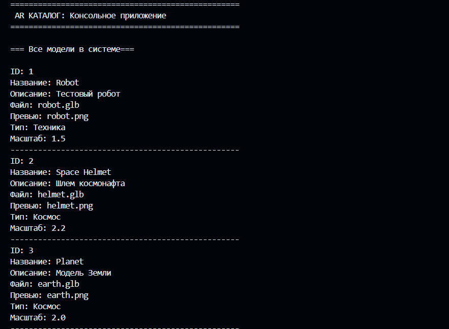
</p>

<p align="center">
  <em>Консольный интерфейс со всеми моделями.</em>
</p>

<p align="center">
  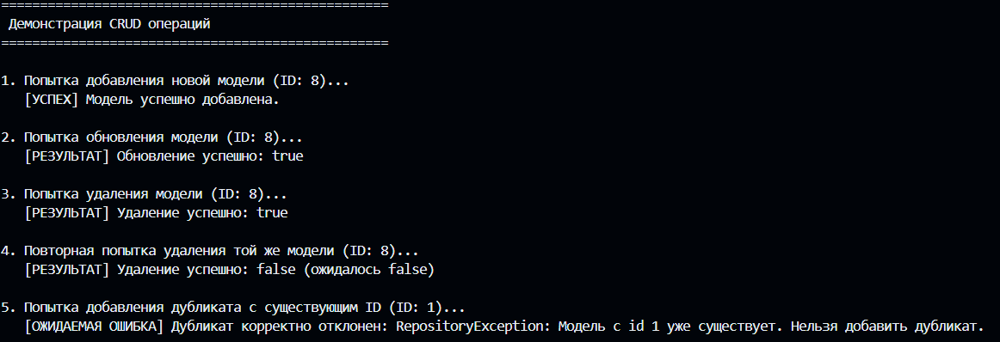
</p>

<p align="center">
  <em>Демонстрация CRUD-операций: добавление, обновление, удаление и обработка дубликатов.</em>
</p>

<p align="center">
  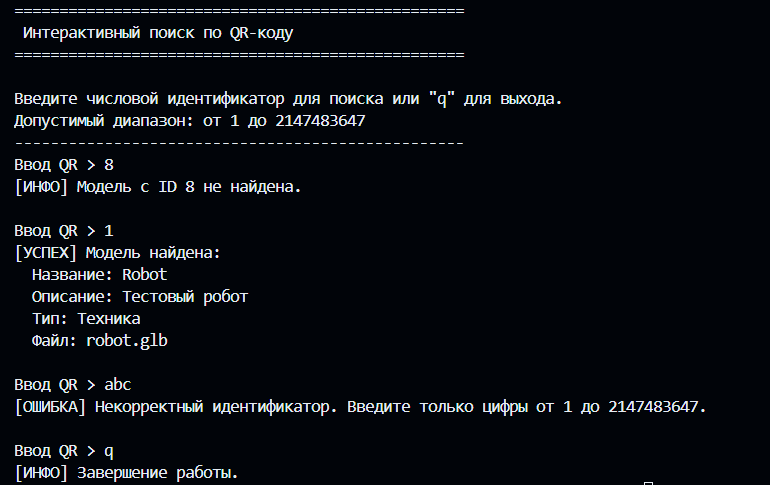
</p>

<p align="center">
  <em>Интерактивный консольный интерфейс с обработкой ввода пользователя.</em>
</p>

<p align="center">
  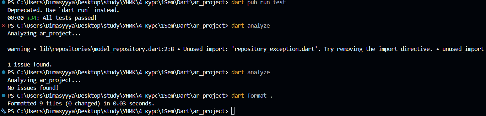
</p>

<p align="center">
  <em>Успешное прохождение всех 34 юнит-тестов.</em>
</p>

Все изображения размещены в каталоге [Demonstration](./Demonstration/).

---

## Лабораторная работа № 3 — Каркас мобильного приложения

**Цель:** Создать Android-приложение, перенести проверенную Dart-логику из предыдущих работ и реализовать три основных экрана интерфейса с соблюдением принципов Flutter.

### Реализовано

- **Инициализация Flutter-проекта:** Создан проект `ar_catalog` внутри существующего Git-репозитория с настройкой `minSdk = 24`.
- **Миграция Dart-слоя:** Полностью перенесены модели (`ArModel`), репозитории (`ModelRepository`, `MemoryModelRepository`) и сервисы (`parseQrId`) из ЛР2. Все импорты адаптированы под пакет `ar_catalog`.
- **Управление зависимостями:** Реализована единая точка сборки зависимостей. Экземпляр `MemoryModelRepository` создается один раз в `main.dart` и передается вниз по дереву виджетов через обязательные параметры.
- **HomeScreen (Главный экран):** 
  - Реализован как `StatefulWidget` для асинхронной загрузки данных.
  - Реализованы состояния: загрузка (`CircularProgressIndicator`), ошибка (с кнопкой повтора), пустой каталог и успешный список.
  - Добавлена проверка `mounted` после `await` для предотвращения ошибок обновления состояния удаленного виджета.
  - Список отображает названия, описания и превью-изображения моделей (`Image.asset` с `errorBuilder`).
- **ScannerScreen и ArScreen:** Созданы заглушки для будущих лабораторных работ с корректной передачей параметров (`ArModel`).
- **Ресурсы (Assets):** Настроена загрузка изображений через `pubspec.yaml`.
- **Widget-тестирование:** Написаны и успешно проходят тесты для всех трех экранов, проверяющие корректность отображения данных и заглушек.

### Структура экранов

| Экран | Назначение | Особенности реализации |
|---|---|---|
| `HomeScreen` | Отображение каталога моделей | Асинхронная загрузка, обработка ошибок, `ListView` |
| `ScannerScreen` | Заглушка для сканера QR | Подготовка интерфейса для ЛР7 |
| `ArScreen` | Заглушка для AR-просмотра | Принимает объект `ArModel`, готов к ЛР8 |

### Проверка и запуск

Для проверки корректности выполнения работы используются следующие команды:

```bash
# Статический анализ кода
flutter analyze

# Запуск всех unit и widget тестов
flutter test

# Сборка APK в режиме отладки
flutter build apk --debug

# Запуск на подключенном устройстве или эмуляторе
flutter run
```

### Демонстрация ЛР № 3

<p align="center">
  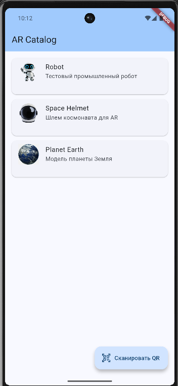
</p>

<p align="center">
  <em>Главный экран приложения с моделями.</em>
</p>

<p align="center">
  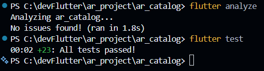
</p>

<p align="center">
  <em>Демонстрация прохождения всех юнит тестов.</em>
</p>

## Лабораторная работа № 4 — Навигация и каталог

**Цель:** превратить каркас AR Catalog в каталог с карточками и переходами между тремя основными экранами. При выборе объекта конкретный экземпляр `ArModel` передаётся на экран `ArScreen`.

### Карточка модели (`ModelCard`)

Создан переиспользуемый виджет `ModelCard`, объединяющий превью, название и описание модели.

- `InkWell` обеспечивает интерактивную область нажатия и Material-эффект обратной связи.
- `AspectRatio` задаёт соотношение сторон карточки 4:3.
- `Image.asset` отображает изображение предварительного просмотра; `errorBuilder` обрабатывает ситуацию, когда ресурс недоступен.
- `TextOverflow.ellipsis` предотвращает чрезмерное увеличение карточки из-за длинного названия или описания.
- `ValueKey(model.id)` обеспечивает стабильную идентификацию элементов при перестроении списка или сетки.

### Адаптивный каталог

Компоновка каталога выбирается с помощью `LayoutBuilder` с учётом доступной ширины экрана:

- при ширине менее 400 пикселей используется вертикальный `ListView.builder`;
- на более широких экранах используется `GridView.builder` с `maxCrossAxisExtent: 300`;
- кнопка в `AppBar` позволяет повторно загрузить каталог.

Такой подход позволяет использовать один экран каталога на устройствах с различной шириной, не создавая отдельные реализации для телефона и более широкого окна.

### Навигация между экранами

- Нажатие на карточку открывает `ArScreen` и передаёт выбранный объект `ArModel`.
- Флаг `_isNavigating` предотвращает запуск нескольких одинаковых переходов из-за повторных нажатий.
- Возврат с экрана просмотра выполняется через `Navigator.pop`, что позволяет вернуться к уже открытому каталогу без ненужного накопления экранов в стеке.
- После асинхронных операций проверяется `mounted`, чтобы не обращаться к состоянию виджета после его удаления.

### Ручной ввод идентификатора в `ScannerScreen`

Поскольку считывание QR-кода камерой пока не реализовано, добавлен ручной ввод идентификатора для проверки сценария поиска и навигации.

- Кнопка «Проверить идентификатор вручную» открывает диалог ввода.
- Значение проверяется с помощью `parseQrId`.
- Некорректный формат и отсутствие модели в каталоге обрабатываются отдельно и отображаются пользователю как ошибки.
- При успешном поиске найденный `ArModel` возвращается вызывающему экрану через `Navigator.pop(context, model)`.
- После возврата результат обрабатывается на `HomeScreen`; при наличии найденной модели приложение может открыть `ArScreen`.

Таким образом, ручной ввод позволяет проверить основной пользовательский сценарий без доступа к камере. Он не является полноценной реализацией сканера QR-кодов.

### Widget-тестирование

Добавлены тесты пользовательских сценариев:

- отображение карточек каталога;
- передача выбранной модели при нажатии на карточку;
- возврат из `ScannerScreen` без выбора модели;
- успешный ручной ввод идентификатора и возврат найденного объекта.

Для запуска тестов Flutter-приложения используется команда `flutter test` из каталога Flutter-проекта.

### Навигационная схема

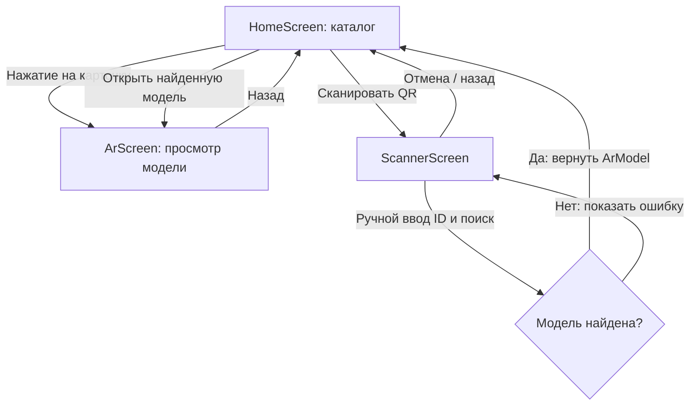

### Демонстрация ЛР № 4

<p align="center">
  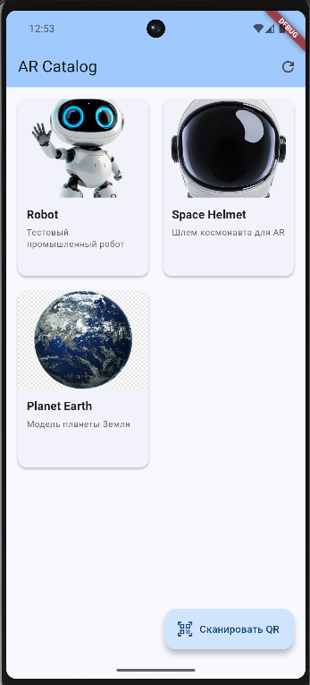
</p>

<p align="center">
  <em>Адаптивная компоновка главной страницы</em>
</p>

<p align="center">
  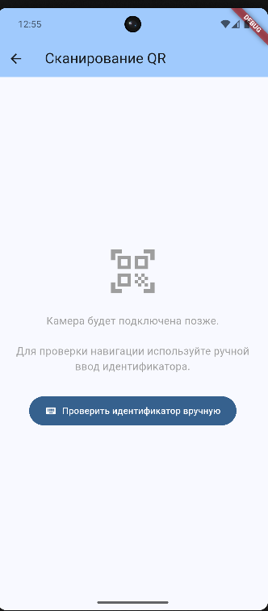
</p>

<p align="center">
  <em>Диалог ручного ввода идентификатора для проверки поиска и навигации.</em>
</p>

<p align="center">
  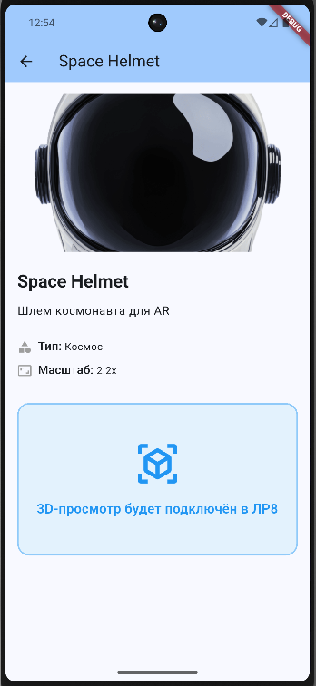
</p>

<p align="center">
  <em>Экран `ArScreen` с информацией о выбранной модели и заглушкой будущего AR-просмотра.</em>
</p>

<p align="center">
  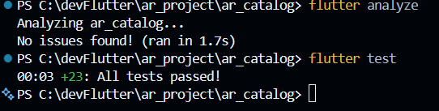
</p>

<p align="center">
  <em>Демонстрация прохождения всех юнит тестов.</em>
</p>

Материалы демонстрации размещены в каталоге [Demonstration](./Demonstration/).


## Лабораторная работа № 5 — Анимации приложения

**Цель:** добавить неявные, явные и межэкранные анимации в AR Catalog для улучшения пользовательского опыта и демонстрации изменения состояния интерфейса.

### Реализовано

- **Неявные анимации карточек (`AnimatedContainer`):**
  - Плавное изменение цвета фона при нажатии.
  - Анимация границы (появление рамки цвета `primary`).
  - Изменение тени для эффекта «поднятия» карточки.
  - Длительность 200 мс с кривой `Curves.easeInOut`.

- **Анимация вспомогательной подписи (`AnimatedOpacity`):**
  - Плавное появление/исчезновение ID модели при нажатии.
  - Использование `IgnorePointer` для блокировки нажатий на невидимый текст (opacity 0.0).
  - Сохранение семантической доступности для скринридеров.

- **Смена состояний каталога (`AnimatedSwitcher`):**
  - Плавный переход между состояниями: загрузка → успех/ошибка/пусто.
  - Уникальные `ValueKey` для каждого состояния (`loading`, `success`, `empty`, `error`).
  - Fade-анимация длительностью 300 мс.
  - Сохранение читаемости и активности элементов управления после перехода.

- **Межэкранная анимация (`Hero`):**
  - Плавный «перелёт» изображения превью из `ModelCard` в `ArScreen`.
  - Уникальный `tag` для каждой модели: префикс + `model.id`.
  - Сохранение соотношения сторон и `clipBehavior` для предотвращения скачков.
  - Корректный обратный переход при нажатии системной кнопки «Назад».

- **Явная анимация сканера (`AnimationController`):**
  - Виджет `ScannerFrame` с пульсирующей рамкой.
  - Использование `SingleTickerProviderStateMixin` для предоставления `vsync`.
  - `Tween<double>` для интерполяции прозрачности границы (0.4 → 1.0).
  - `CurvedAnimation` с `Curves.easeInOut` для плавности.
  - `AnimatedBuilder` для оптимизации перерисовки (только рамка, не весь экран).
  - Запуск `repeat(reverse: true)` только в состоянии `waiting`.
  - Остановка анимации в состояниях `processing` и `error`.
  - Корректное освобождение контроллера в `dispose()`.
  - Обработка изменения статуса через `didUpdateWidget()`.
  - Поддержка `MediaQuery.disableAnimations` (статичная рамка при reduced motion).

- **Widget-тестирование анимаций:**
  - Тесты для `ModelCard`: проверка промежуточного кадра анимации (100 мс) и блокировки нажатий через `IgnorePointer`.
  - Тесты для `ScannerFrame`: использование `tester.pump(duration)` вместо `pumpAndSettle()` для избежания зависания на бесконечной анимации.
  - Тесты для навигации: проверка открытия диалогов и возврата результатов.
  - Все тесты проходят успешно без ошибок `Ticker was active when disposed` и `setState after dispose`.

### Технологии анимации

| Компонент | Назначение | Параметры |
|---|---|---|
| `AnimatedContainer` | Анимация свойств карточки | duration: 200ms, curve: easeInOut |
| `AnimatedOpacity` | Плавное появление/исчезновение текста | duration: 200ms |
| `AnimatedSwitcher` | Смена состояний каталога | duration: 300ms, FadeTransition |
| `Hero` | Межэкранный переход изображения | tag: `model-hero-{id}` |
| `AnimationController` | Управление явной анимацией рамки | duration: 1500ms, repeat |
| `Tween<double>` | Интерполяция значений прозрачности | 0.4 → 1.0 |
| `CurvedAnimation` | Изменение скорости анимации | curve: easeInOut |
| `AnimatedBuilder` | Оптимизация перерисовки | rebuild только рамки |

### Сценарии использования анимаций

| Сценарий | Анимация | Ожидаемое поведение |
|---|---|---|
| Нажатие на карточку | `AnimatedContainer` + `AnimatedOpacity` | Плавная реакция, появление рамки и ID |
| Загрузка каталога | `AnimatedSwitcher` | Плавный переход от индикатора к сетке |
| Ошибка загрузки | `AnimatedSwitcher` | Появление сообщения и кнопки «Повторить» |
| Открытие модели | `Hero` | Изображение «перелетает» в `ArScreen` |
| Возврат из `ArScreen` | `Hero` | Изображение возвращается в карточку |
| Ожидание сканера | `AnimationController` | Пульсация рамки (opacity 0.4 → 1.0) |
| Обработка ввода | `ScannerFrame` | Остановка пульсации, оранжевая рамка + спиннер |
| Ошибка ввода | `ScannerFrame` | Красная рамка + иконка ошибки |
| Reduced motion | `MediaQuery` | Статичная рамка без анимации |

### Widget-тестирование

Добавлены специализированные тесты для проверки анимаций:

| Файл тестов | Проверяемая функциональность |
|---|---|
| `model_card_test.dart` | Промежуточный кадр `AnimatedContainer`, `IgnorePointer` при opacity 0 |
| `scanner_frame_test.dart` | Отсутствие зависания на `pump()`, корректная остановка анимации |
| `screens_test.dart` | Навигация с анимациями, открытие диалогов, возврат результатов |

**Особенности тестирования:**
- Использование `tester.startGesture()` для проверки состояния во время удержания нажатия.
- Использование `tester.pump(duration)` вместо `pumpAndSettle()` для экранов с бесконечной анимацией.
- Проверка свойств виджетов через `tester.widget<>()` с `find.descendant()`.
- Обработка `MediaQuery.disableAnimations` в тестах.

### Демонстрация ЛР № 5

<p align="center">
  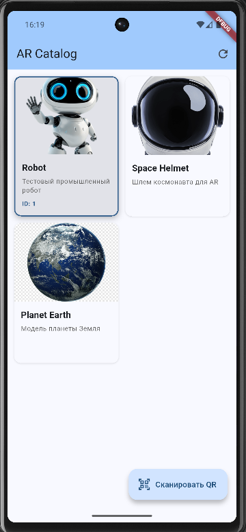
</p>

<p align="center">
  <em>Анимация карточки: изменение цвета фона, появление рамки и id при нажатии.</em>
</p>

<p align="center">
  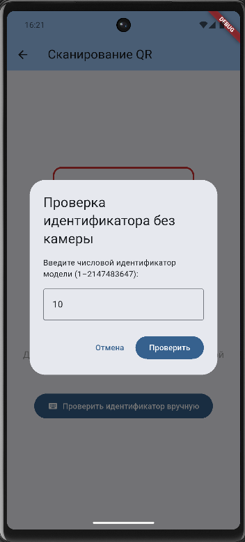
</p>

<p align="center">
  <em>ScannerFrame: пульсирующая рамка в состоянии ошибки.</em>
</p>

<p align="center">
  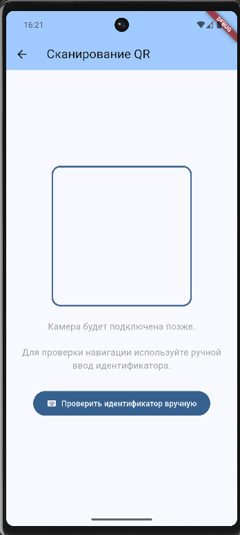
</p>

<p align="center">
  <em>ScannerFrame: пульсирующая рамка в состоянии ожидания (AnimationController с repeat).</em>
</p>

<p align="center">
  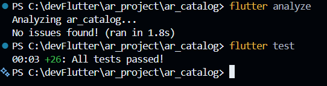
</p>

<p align="center">
  <em>Успешное прохождение всех widget-тестов для анимаций.</em>
</p>

Материалы демонстрации размещены в каталоге [Demonstration](./Demonstration/).

---

## Лабораторная работа № 6 — Локальная база 3D-моделей

**Цель:** заменить `MemoryModelRepository` реализацией на базе SQLite, сохранив контракт `ModelRepository` и существующую работу пользовательского интерфейса. После первого запуска каталог должен инициализироваться начальными данными, а внесённые пользователем изменения — сохраняться после полного закрытия и повторного запуска приложения.

### Реализовано

- **Подключение зависимостей.** Добавлены пакеты `sqflite` для работы с SQLite и `path` для формирования пути к файлу базы данных.
- **Схема базы данных.** Создана таблица `ar_models`, предназначенная для хранения основных характеристик 3D-моделей.
- **Сервис `DatabaseService`.** Реализовано открытие и управление жизненным циклом базы данных. Результат открытия кешируется в `Future`, чтобы избежать повторного параллельного открытия одного и того же файла. В `onCreate` создаётся таблица и добавляются начальные записи; `onUpgrade` предусмотрен для обработки изменения версии схемы.
- **Преобразование данных.** Создан `ArModelMapper`, преобразующий экземпляры `ArModel` в формат `Map<String, Object?>`, подходящий для SQLite, и восстанавливающий объекты из полученных записей. При преобразовании выполняется проверка типов данных.
- **Репозиторий `SqliteModelRepository`.** Реализован контракт `ModelRepository` на основе SQLite. Поддерживаются получение всех моделей, поиск по ID, добавление, обновление и удаление записей. Для передачи значений используются параметризованные запросы, а ошибки хранилища обрабатываются на уровне репозитория.
- **Обработка дубликатов.** Попытка добавить модель с уже существующим идентификатором обрабатывается как ошибка репозитория (`RepositoryException`), а не как успешная вставка.
- **Интеграция с интерфейсом.** Приложение переключено с `MemoryModelRepository` на `SqliteModelRepository`. В `HomeScreen` добавлены диалоги редактирования названия и удаления модели, вызываемые долгим нажатием на карточку.
- **Постоянное хранение.** Изменения каталога записываются в локальную базу и сохраняются после закрытия и повторного запуска приложения.
- **Интеграционные тесты.** В `integration_test/database_test.dart` добавлены проверки создания начальных записей, сохранения изменений после повторного открытия базы, CRUD-операций и обработки дубликатов.

### Схема таблицы `ar_models`

| Поле | Назначение |
|---|---|
| `id` | Уникальный идентификатор модели |
| `title` | Название модели |
| `description` | Описание объекта |
| `model_path` | Путь к файлу 3D-модели |
| `preview_path` | Путь к изображению предварительного просмотра |
| `scale` | Масштаб модели |

Названия столбцов в базе данных представлены в формате `snake_case`, тогда как модель Dart использует поля объекта `ArModel`. За преобразование между этими представлениями отвечает `ArModelMapper`.

### Архитектура работы с базой данных

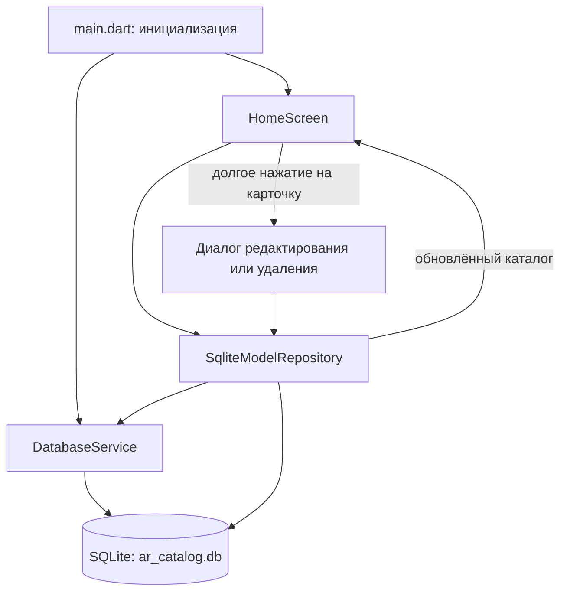

`DatabaseService` отвечает за доступ к файлу базы данных и её инициализацию. `SqliteModelRepository` скрывает SQL-операции за интерфейсом `ModelRepository`, поэтому экран каталога работает с моделями через методы репозитория, не выполняя запросы к SQLite самостоятельно.

### Интеграционное тестирование

Интеграционные тесты проверяют не только отдельные методы, но и взаимодействие с реальным SQLite-хранилищем в рамках тестового сценария.

| Сценарий | Ожидаемое поведение |
|---|---|
| Первый запуск | Создаётся таблица `ar_models` и добавляются 3 начальные записи |
| Сохранность данных | Изменённое значение `title` сохраняется после закрытия базы и повторного открытия |
| Добавление | Новая модель сохраняется и доступна при последующем чтении |
| Обновление | Существующая запись получает новые значения |
| Удаление | Удалённая запись отсутствует в результатах поиска и в каталоге |
| Дубликат | Вставка записи с существующим `id` приводит к `RepositoryException` |
| Пустой каталог | После удаления всех записей `getAll()` возвращает пустой список |

Для запуска интеграционных тестов из каталога Flutter-приложения используется команда:

```bash
flutter test integration_test/database_test.dart
```

### Демонстрация ЛР № 6

<p align="center">
  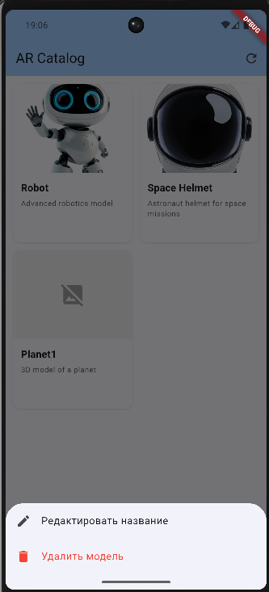
</p>

<p align="center">
  <em>Диалог редактирования названия модели и ее удаления.</em>
</p>

<p align="center">
  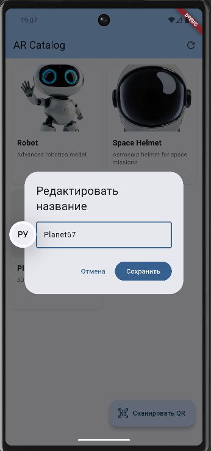
</p>

<p align="center">
  <em>Данные, сохранённые в SQLite, отображаются после полного закрытия и повторного запуска приложения.</em>
</p>

<p align="center">
  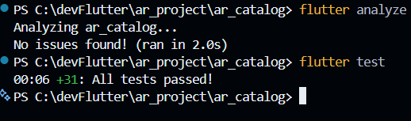
</p>

<p align="center">
  <em>Результат выполнения интеграционных тестов SQLite на Android-устройстве.</em>
</p>

Материалы демонстрации размещены в каталоге [Demonstration](./Demonstration/).

---

## Архитектура проекта

Приложение разделяет модель данных, слой доступа к данным и пользовательский интерфейс. `SqliteModelRepository` реализует контракт `ModelRepository` и выполняет CRUD-операции с локальной базой SQLite через `DatabaseService`. `HomeScreen` загружает и отображает каталог, обрабатывает навигацию и инициирует операции редактирования и удаления. Выбранный экземпляр `ArModel` передаётся в `ArScreen`; `ScannerScreen` возвращает найденную модель вызывающему экрану после ручного ввода идентификатора.

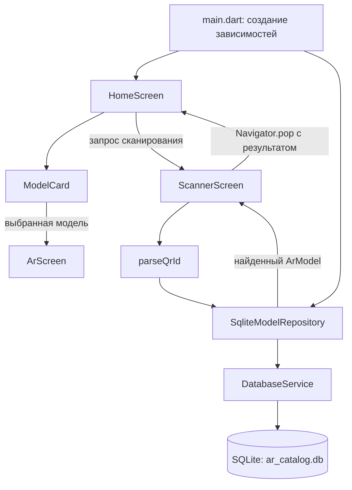

### Назначение компонентов

| Компонент | Ответственность |
|---|---|
| `ArModel` | Описание свойств 3D-модели |
| `ArModelType` | Типизация объектов |
| `ModelRepository` | Контракт доступа к данным |
| `SqliteModelRepository` | CRUD-операции с каталогом через SQLite |
| `DatabaseService` | Инициализация и открытие локальной базы данных |
| `ArModelMapper` | Преобразование `ArModel` в записи базы данных и обратно |
| `parseQrId()` | Проверка и преобразование идентификатора |
| `HomeScreen` | Загрузка и отображение каталога, обработка навигации |
| `ModelCard` | Отображение карточки отдельной модели |
| `ScannerScreen` | Ручной ввод идентификатора и возврат найденной модели |
| `ArScreen` | Экран выбранной модели; AR-функциональность пока представлена заглушкой |
| `main.dart` | Инициализация приложения и создание зависимостей |

---

## Структура проекта

Основные части репозитория — консольная реализация предыдущих лабораторных работ и Flutter-приложение `ar_catalog`. В Flutter-части логика разделена между моделью данных, SQLite-хранилищем, репозиторием, экранами и переиспользуемым виджетом карточки. Интеграционные тесты базы данных находятся в `integration_test/`.

```text
ar-model-viewer_DART-FLUTTER/
├── bin/
│   └── main.dart                 # Точка входа консольной версии
├── lib/                          # Dart-модель, репозиторий и логика
├── ar_catalog/                   # Flutter-приложение
│   ├── lib/                      # Экраны и компоненты приложения
│   ├── test/                     # Unit- и widget-тесты
│   └── pubspec.yaml              # Зависимости Flutter-проекта
├── pubspec.yaml                  # Конфигурация Dart-пакета
├── analysis_options.yaml          # Настройки статического анализа
├── CHANGELOG.md                  # История изменений
└── README.md                     # Документация проекта
```

## Технологии

| Технология | Назначение | Статус |
|---|---|---|
| Dart | Модель данных и логика приложения | Используется |
| Dart SDK | Запуск консольной программы | Используется |
| `Future`, `async/await` | Асинхронный доступ к данным | Используется |
| Git | Контроль версий | Используется |
| GitHub | Хранение исходного кода | Используется |
| Flutter | Мобильный интерфейс | Используется с ЛР № 3 |
| Material widgets (`InkWell`, `ListView`, `GridView`) | Построение каталога и интерактивных карточек | Используется |
| `LayoutBuilder` | Адаптивный выбор компоновки каталога | Используется с ЛР № 4 |
| `Navigator` | Переходы между экранами и возврат результата | Используется с ЛР № 4 |
| Flutter widget tests | Проверка экранов и навигационных сценариев | Используется |
| SQLite (`sqflite`) | Постоянное локальное хранение каталога | Используется с ЛР № 6 |
| AR | Отображение моделей в дополненной реальности | Планируется |

---

## Запуск проекта

### Требования

- Установленный [Dart SDK](https://dart.dev/get-dart).
- Установленный [Flutter SDK](https://docs.flutter.dev/get-started/install) для мобильного приложения.
- Git.
- Терминал или командная строка.
- Для Android — настроенная среда Android SDK и устройство или эмулятор.

### 1. Клонирование репозитория

```bash
git clone https://github.com/Dimasyaaa/ar-model-viewer_DART-FLUTTER.git
```

### 2. Переход в каталог проекта

```bash
cd ar-model-viewer_DART-FLUTTER
```

### 3. Получение зависимостей

```bash
dart pub get
```

### 4. Запуск консольной версии

```bash
dart run bin/main.dart
```

### 5. Запуск Flutter-приложения (ЛР № 3–6)

Flutter-проект расположен в каталоге `ar_catalog`:

```bash
cd ar_catalog
flutter pub get
flutter run
```

Для проверки приложения выполните из каталога `ar_catalog`:

```bash
flutter analyze
flutter test
flutter build apk --debug
```

Консольная версия и Flutter-приложение являются отдельными точками запуска в рамках одного репозитория.

---


## Разработчик

**Корнилов Дмитрий Сергеевич**

Группа: **ИВТ-ВТД-23**

Учебный проект, разрабатываемый в рамках лабораторных работ по Dart и Flutter.

